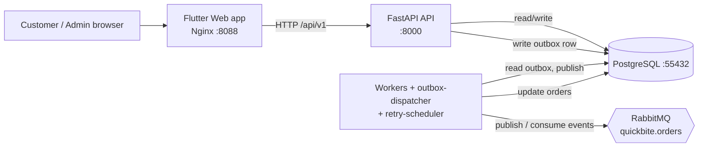

# 1. System Overview

## Purpose

- This document explains what QuickBitee is, in plain words.
- It shows the big pieces of the system and how they talk to each other.
- Read this first. Every other Knowledge Byte builds on it.

## What the project does

- QuickBitee is a food-delivery demo application.
- A customer signs in, browses restaurants, adds food to a cart, and places an order.
- After the order is placed, background workers move it through stages: payment, restaurant confirmation, and driver assignment.
- An admin can watch orders and see statistics in an admin console.
- The project is a learning/showcase system. Payments and drivers are simulated (fake but deterministic).

## Who uses the application

- **Customer** — browses food, orders, tracks the order, reads notifications.
- **Admin** — views all orders, customers, deliveries, and analytics.
- There are only two roles in the code: `customer` and `admin`. See `backend/app/models/users.py`.

## Main features

- Email + password login (JWT tokens).
- Restaurant and dish catalogue with search, filters, and sorting.
- Cart that belongs to one restaurant at a time.
- Checkout with a safe, idempotent order placement (no double orders).
- Live order tracking that updates about every 2 seconds.
- Notification feed.
- Admin dashboard: orders, restaurants, menu items, customers, deliveries, analytics.

## Technology stack

| Layer | Technology | Why it exists here |
|---|---|---|
| Web app | Flutter (Dart) | One codebase that builds a browser UI. |
| App state | Riverpod | Holds auth, cart, and screen data in memory. |
| Navigation | go_router | Maps URLs to screens. |
| HTTP client | Dio | Sends API requests from the app. |
| Backend | Python 3.11 + FastAPI | Serves the JSON API. |
| Backend validation | Pydantic v2 | Checks request/response shapes. |
| Database access | SQLAlchemy 2 (async) | Talks to PostgreSQL without blocking. |
| Migrations | Alembic | Creates/updates database tables. |
| Authentication | PyJWT + bcrypt | Signs tokens, hashes passwords. |
| Message broker | RabbitMQ + aio-pika | Carries order events between workers. |
| Database | PostgreSQL 16 | Stores all business data. |
| Web server | Nginx | Serves the Flutter build and proxies `/api`. |
| Containers | Docker Compose | Starts the whole stack with one command. |

## Main application components

- **Web app (Flutter)** — runs in the browser at `http://localhost:8088`.
- **API (FastAPI)** — runs at `http://localhost:8000`, routes under `/api/v1`.
- **PostgreSQL** — the single source of truth. Host port `55432`.
- **RabbitMQ** — message broker with a topic exchange `quickbite.orders`.
- **Workers** — small processes that react to order events:
  - `payment-worker`, `restaurant-worker`, `delivery-worker`, `notification-worker`.
  - `outbox-dispatcher` — reads new events from the database and publishes them to RabbitMQ.
  - `retry-scheduler` — redelivers failed events after a delay.

## How the components communicate

- The web app talks to the API with HTTP + JSON.
- Nginx forwards `/api/...` requests to the API container (see `frontend/nginx.conf`).
- The API never publishes to RabbitMQ while serving a request.
- Instead, the API saves an event row in the `outbox_events` table in the *same* database transaction as the order.
- The `outbox-dispatcher` then publishes those rows to RabbitMQ.
- Workers consume events, change the order, and write a *new* event into the outbox. The cycle repeats.

## Where the application stores data

- Everything persistent lives in PostgreSQL.
- Important tables: `users`, `restaurants`, `menu_items`, `categories`, `orders`, `order_items`, `order_status_history`, `notifications`, `outbox_events`, `processed_events`, `retry_jobs`, `quarantine_records`.
- Model files: `backend/app/models/users.py`, `catalog.py`, `orders.py`, `messaging.py`.

## How a request travels through the system

1. The user does something in the Flutter app, for example taps **Place order**.
2. The Flutter app sends an HTTP request to `/api/v1/orders` through Nginx.
3. Nginx forwards it to the FastAPI container.
4. FastAPI checks the JWT token, validates the body, and runs the order service.
5. The order service reads menu prices and writes the order + an outbox event in one transaction.
6. FastAPI returns `202 Accepted` with the order id.
7. The `outbox-dispatcher` publishes the event to RabbitMQ.
8. Workers pick it up, change the order status, and add new events.
9. The Flutter app polls the API and shows the new status.

## Architecture diagram

## Diagram explained

1. The user only ever talks to the Flutter web app in the browser.
2. The web app calls the API over HTTP. Nginx proxies `/api` to the API container.
3. The API reads and writes PostgreSQL. It also writes outbox rows there.
4. Workers read those outbox rows, publish messages to RabbitMQ, and consume messages.
5. Workers write the new order state back to PostgreSQL.
6. The web app polls the API to see status changes. There is no direct server push to the browser.

## Example

- Customer places an order.
- The API saves the order with status `PENDING` and an `order.created` outbox event.
- The dispatcher publishes `order.created`.
- The `payment-worker` consumes it, marks the order `PAID`, and emits `order.paid`.
- The `restaurant-worker` then marks it `CONFIRMED`, and the `delivery-worker` marks it `DRIVER_ASSIGNED`.
- The tracking screen, which polls every 2 seconds, shows each new stage.

## What to remember

- QuickBitee is a food-delivery demo with a Flutter web front end and a FastAPI back end.
- PostgreSQL is the single source of truth; RabbitMQ carries events between services.
- The API uses a *transactional outbox*: it saves the event with the business change, then a separate process publishes it.
- Workers are separate containers that move the order through a fixed status sequence.
- The browser learns about progress by polling, not by websockets or push.

## Builds on

None (first byte).
