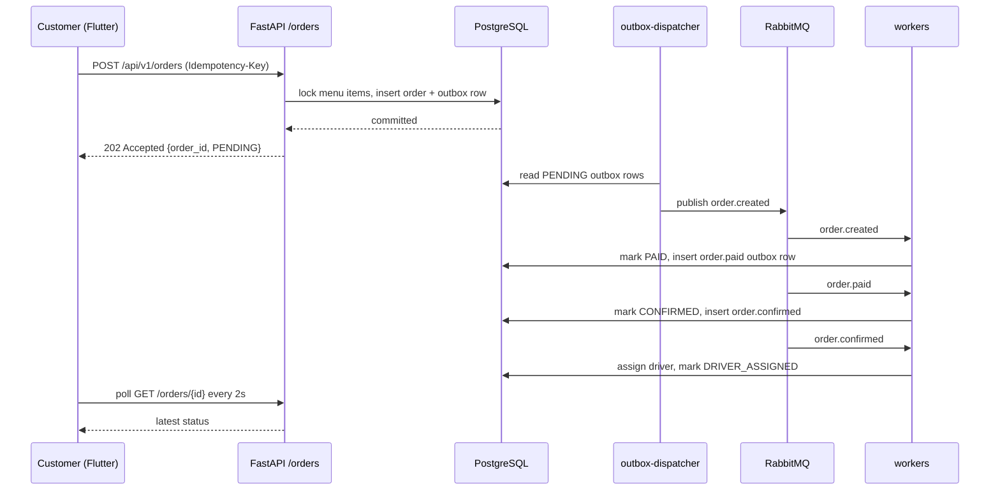

# 4. Request and Data Flow

## Purpose

- This document follows one real user action from the first click to the final screen.
- The action is: a customer places an order.
- It connects frontend code, backend code, the database, and the workers.

## The user action: place an order

- The customer fills the checkout form and taps **Place order**.
- QuickBitee must save exactly one order, even if the button is tapped twice or the network is slow.
- Then background workers must move the order from `PENDING` to `DRIVER_ASSIGNED`.

## Files involved

Frontend:

- `frontend/lib/features/checkout/checkout_screen.dart` — the button and the submit function `_placeOrder`.
- `frontend/lib/core/api_client.dart` — `placeOrder(...)` sends the HTTP request.
- `frontend/lib/state/cart_controller.dart` — holds the cart being sent.
- `frontend/lib/state/auth_controller.dart` — provides the API client and the token.

Backend:

- `backend/app/api/v1/orders.py` — `place_order(...)` is the endpoint.
- `backend/app/api/dependencies.py` — `get_current_user` checks the token.
- `backend/app/services/order_service.py` — `create_order(...)` does the real work.
- `backend/app/messaging/outbox.py` — `emit_outbox(...)` saves the event.
- `backend/app/models/orders.py` — the `Order`, `OrderItem`, and `IdempotencyRecord` tables.

Workers:

- `backend/workers/outbox_dispatcher.py` and `backend/app/messaging/outbox.py` — publish the event.
- `backend/workers/payment_worker.py`, `restaurant_worker.py`, `delivery_worker.py` — move the status forward.
- `backend/workers/notification_worker.py` — writes the notification feed entries.

## How it works

1. The user taps **Place order** in `checkout_screen.dart`.
2. `_placeOrder()` checks the form, then reads the cart from `cartProvider`.
3. It calls `ref.read(apiClientProvider).placeOrder(...)` with the restaurant id, address, items, and an idempotency key.
4. `ApiClient.placeOrder` sends `POST /api/v1/orders` with the header `Idempotency-Key`.
5. Nginx proxies the request to the API container.
6. FastAPI routes it to `place_order` in `backend/app/api/v1/orders.py`.
7. `get_current_user` decodes the JWT and loads the `User` row.
8. `place_order` checks the user is a `customer` and that the idempotency key is 8–80 characters.
9. `create_order` runs: it checks for an existing idempotency record, loads the restaurant, locks the menu items, and computes the total.
10. It writes the `Order`, the `OrderItem` rows, a history row, an idempotency record, and an outbox event, all in one transaction.
11. `place_order` calls `await session.commit()`.
12. The API returns `202 Accepted` with `order_id`, `status`, `total_minor`, and a message.
13. The frontend clears the cart and navigates to `/checkout-ack`.
14. Meanwhile, the `outbox-dispatcher` finds the `PENDING` outbox row and publishes it to RabbitMQ.
15. `payment-worker` consumes `order.created`, marks the order `PAID`, and writes an `order.paid` event to the outbox.
16. `restaurant-worker` consumes `order.paid`, marks it `CONFIRMED`, and emits `order.confirmed`.
17. `delivery-worker` consumes `order.confirmed`, assigns a driver, and marks it `DRIVER_ASSIGNED`.
18. `notification-worker` listens to `order.#` and saves one notification row per event type.
19. The tracking screen (`frontend/lib/features/orders/order_detail_screen.dart`) polls the API every 2 seconds and shows each new stage.

## Sequence diagram



## Important code

### 1. The endpoint

`backend/app/api/v1/orders.py`:

```python
@router.post(
    "/orders",
    response_model=OrderAcceptedResponse,
    status_code=status.HTTP_202_ACCEPTED,
)
async def place_order(
    payload: OrderCreateRequest,
    idempotency_key: str | None = Header(default=None, alias="Idempotency-Key"),
    session: AsyncSession = Depends(get_session),
    current_user: User = Depends(get_current_user),
) -> OrderAcceptedResponse:
    if current_user.role != "customer":
        raise ForbiddenError("Only customers can place orders.")
    if not idempotency_key or len(idempotency_key) < 8 or len(idempotency_key) > 80:
        raise InvalidRequestError("A valid Idempotency-Key header (8-80 chars) is required.")
    result = await create_order(session, current_user.id, payload, idempotency_key)
    await session.commit()
    return result
```

- This is the door into the system for a new order.
- It returns `202 Accepted` because the order is accepted for *later* processing, not finished yet.
- `session.commit()` is the single point that saves everything.

### 2. The safety rule (idempotency)

`backend/app/services/order_service.py`:

```python
payload_hash = canonical_payload_hash(payload)

existing = await session.execute(
    select(IdempotencyRecord)
    .where(
        IdempotencyRecord.customer_id == customer_id,
        IdempotencyRecord.idem_key == idempotency_key,
    )
    .with_for_update()
)
record = existing.scalar_one_or_none()
if record is not None:
    return _replay(record, payload_hash)
```

- If the same customer sends the same key again, the service replays the *stored* response instead of creating a second order.
- This is what stops a double-tap or a network retry from charging twice.

### 3. The outbox event

`backend/app/services/order_service.py`:

```python
envelope = new_envelope(
    EVENT_ORDER_CREATED,
    order_id=order.id,
    order_version=1,
    correlation_id=order.id,
    data={...},
)
await emit_outbox(session, envelope)
```

- The event is saved in the same transaction as the order.
- Because it is in the same transaction, the event exists only if the order exists. This is the *transactional outbox* pattern.

## Data flow

- **Enters the endpoint:** a JWT token, an `Idempotency-Key` header, and a JSON body with `restaurant_id`, `delivery_address`, and a list of items.
- **Enters `create_order`:** the customer id, the validated payload, and the idempotency key.
- **The database writes:** one `orders` row, several `order_items` rows, one `order_status_history` row, one `idempotency_records` row, and one `outbox_events` row.
- **Leaves the endpoint:** JSON `{ order_id, status: "PENDING", total_minor, currency, message }`.
- **Leaves the outbox:** an `order.created` message to RabbitMQ.
- **Receives the result:** the Flutter checkout screen, which navigates to `/checkout-ack`, then the tracking screen polls `GET /api/v1/orders/{order_id}`.

## API endpoints used in this flow

- `POST /api/v1/orders` — place the order. Needs `Authorization` and `Idempotency-Key`.
- `GET /api/v1/orders/{order_id}` — used by the tracking screen to poll the latest status.
- `GET /api/v1/orders/{order_id}/history` — the status timeline.
- `GET /api/v1/notifications` — the notification feed.

## Example

- Customer places an order of 2 × Chicken 65 Biryani.
- The API returns `202` with order id `5b882aa3...` and status `PENDING`.
- Within about two seconds the payment worker marks it `PAID`, then the restaurant worker marks it `CONFIRMED`, then the delivery worker marks it `DRIVER_ASSIGNED`.
- The tracking screen updates about every 2 seconds and stops polling once the status is terminal.

## What to remember

- The HTTP request only creates the order. It does not move it through the pipeline.
- `place_order` returns immediately with `202 Accepted`; workers do the slow work.
- Idempotency is enforced with the `Idempotency-Key` header and the `idempotency_records` table.
- The order and its first event are saved in one database transaction (the transactional outbox).
- The frontend learns about progress by polling, so no push technology is needed.

## Builds on

- 1. System Overview
- 2. Project Structure
- 3. Application Startup
