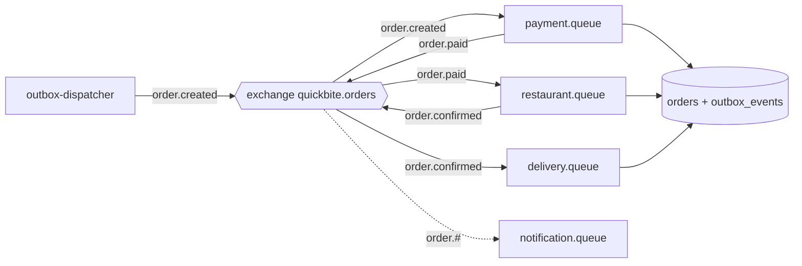

# 9. Order Pipeline, Messaging and Workers

## Purpose

- This document explains how an order moves from `PENDING` to `DRIVER_ASSIGNED`.
- It explains the message broker (RabbitMQ), the outbox, and each worker.
- It shows why the system can lose a container and still finish the order.

## Files involved

- `backend/app/domain/order_state_machine.py` — the allowed status transitions.
- `backend/app/domain/events.py` — event names, routing keys, and the event envelope.
- `backend/app/messaging/outbox.py` — write and dispatch outbox events.
- `backend/app/messaging/topology.py` — declare exchanges and queues.
- `backend/app/messaging/publisher.py` — publish a message.
- `backend/app/messaging/consumer.py` — the shared consumer loop.
- `backend/workers/common.py` — the shared worker core.
- `backend/workers/outbox_dispatcher.py` — the dispatcher process.
- `backend/workers/payment_worker.py`, `restaurant_worker.py`, `delivery_worker.py`, `notification_worker.py` — the stage workers.

## The status state machine

`backend/app/domain/order_state_machine.py`:

```python
ALLOWED_TRANSITIONS: dict[str, set[str]] = {
    STATUS_PENDING: {STATUS_PAID, STATUS_PAYMENT_FAILED},
    STATUS_PAID: {STATUS_CONFIRMED, STATUS_FAILED},
    STATUS_CONFIRMED: {STATUS_DRIVER_ASSIGNED, STATUS_FAILED},
}
```

- `PENDING → PAID → CONFIRMED → DRIVER_ASSIGNED` is the happy path.
- `PENDING → PAYMENT_FAILED` and `PAID/CONFIRMED → FAILED` are the failure paths.
- `assert_transition(...)` raises a `ConflictError` if the move is not allowed, so bad transitions are blocked.

## The events

| Event type | Routing key | Published when |
|---|---|---|
| `order.created` | `order.created` | A customer places an order. |
| `order.paid` | `order.paid` | Payment succeeded. |
| `order.payment.failed` | `order.payment.failed` | Payment failed for good. |
| `order.confirmed` | `order.confirmed` | The restaurant confirmed. |
| `order.driver.assigned` | `order.driver.assigned` | A driver was assigned. |
| `order.failed` | `order.failed` | The order failed terminally. |

### Queue bindings

`backend/app/domain/events.py`:

```python
WORKER_BINDINGS: list[tuple[str, str, str]] = [
    ("payment.queue", EVENT_ORDER_CREATED, "order.created"),
    ("restaurant.queue", EVENT_ORDER_PAID, "order.paid"),
    ("delivery.queue", EVENT_ORDER_CONFIRMED, "order.confirmed"),
    ("notification.queue", "order.#", "order.#"),
]
```

- The notification queue uses the wildcard `order.#`, so it receives *every* order event.
- The other queues each receive exactly one kind of event.

## The transactional outbox

The rule: never publish to RabbitMQ during an HTTP request.

1. When the order changes, the code also writes a row into `outbox_events` in the same transaction.
2. The `outbox-dispatcher` process reads `PENDING` rows and publishes them.
3. After a successful publish (with publisher confirms), it marks the row `SENT`.

`backend/app/messaging/outbox.py`:

```python
async def emit_outbox(session: AsyncSession, envelope: EventEnvelope) -> None:
    from app.models.messaging import OutboxEvent
    session.add(
        OutboxEvent(
            event_type=envelope.event_type,
            routing_key=ROUTING_KEYS[envelope.event_type],
            payload=envelope.to_dict(),
            status="PENDING",
        )
    )
```

- `emit_outbox` only *adds* a row. It does not publish anything.
- The caller's single `commit()` saves the business change and the event together.
- This is why the system never loses an event when a request succeeds.

### How the dispatcher avoids double publishing

- It claims a batch with `SELECT ... FOR UPDATE SKIP LOCKED`.
- It sets a 30-second lease (`lease_owner`, `lease_until`).
- It publishes with `mandatory=True`, so an unroutable message fails loudly.
- If publishing fails, it increases `attempts` and sets `next_retry_at` with a backoff.

## The shared worker core

`backend/workers/common.py`:

```python
async def process_business_event(consumer_name, envelope, attempt, effect) -> None:
    maybe_crash("before_tx", envelope.event_id)
    async with SessionFactory() as session:
        async with session.begin():
            is_new = await record_processed(session, consumer_name, envelope.event_id)
            if not is_new:
                return  # duplicate event acknowledged
            order = await load_order_for_event(session, envelope)
            if order.version != envelope.order_version:
                raise ProcessFailure(f"Order version mismatch: ...")
            await effect(session, order, envelope, attempt)
    maybe_crash("after_tx", envelope.event_id)
```

Steps in plain words:

1. Insert a dedupe row for `(consumer_name, event_id)`. If it already exists, this event was handled before, so skip it.
2. Lock the order row with `SELECT ... FOR UPDATE`.
3. Check the order's `version` matches the event. If not, this event is stale.
4. Run the worker-specific effect.
5. Commit once. The consumer acks the message after this returns.

## Each worker's effect

- **Payment worker** — sleeps `SIM_PAYMENT_DELAY_SECONDS`, inserts a `simulated_payments` row, moves the order to `PAID`, and emits `order.paid`.
- **Restaurant worker** — sleeps, moves the order to `CONFIRMED`, and emits `order.confirmed`.
- **Delivery worker** — sleeps, inserts a `driver_assignments` row (a driver is chosen from a fixed list using `random.Random(order.id)` so it is stable for the same order), moves to `DRIVER_ASSIGNED`, and emits `order.driver.assigned`.
- **Notification worker** — sleeps, then upserts one `notifications` row per event type. It never changes the order. See `NOTIFICATION_TEMPLATES` in `notification_worker.py`.

## The consumer loop

`backend/app/messaging/consumer.py`:

- Connects to RabbitMQ, sets `prefetch_count=1` (one unacked message at a time), declares the topology, and starts consuming.
- On a bad payload, it quarantines the message.
- On a known `ProcessFailure`, it schedules a durable retry.
- On success, it acks the message.

## Pipeline diagram



### Diagram explained

1. The dispatcher publishes `order.created` from the outbox.
2. The payment worker consumes it, updates the order, and emits `order.paid`.
3. The restaurant worker consumes `order.paid` and emits `order.confirmed`.
4. The delivery worker consumes `order.confirmed` and finishes the pipeline.
5. The notification worker receives every event because it binds `order.#`.

## Data flow

- **Enters the dispatcher:** `PENDING` rows from `outbox_events`.
- **Enters a worker:** an event envelope with `event_id`, `order_id`, `order_version`, and `data`.
- **A worker writes:** the new `orders.status`, a new `order_status_history` row, any table for its stage, and a new `outbox_events` row.
- **Leaves:** the next message on the exchange.
- **The user sees:** the new status on the tracking screen, which polls the API.

## Example

- The payment worker receives `order.created` for order `5b882aa3` at version 1.
- It inserts a payment row, sets the order to `PAID` (version 2), and adds an `order.paid` outbox row.
- The dispatcher publishes `order.paid`, and the restaurant worker sets the order to `CONFIRMED` (version 3).
- Finally the delivery worker sets `DRIVER_ASSIGNED` (version 4) and adds a driver row.
- The notification worker saves four notification rows (one per event type).

## What to remember

- The order follows a fixed state machine: `PENDING → PAID → CONFIRMED → DRIVER_ASSIGNED`.
- Events are written to the database first (outbox) and published later by a separate process.
- Each worker is idempotent: it dedupes by `(consumer_name, event_id)` and checks the order version.
- RabbitMQ topic queues route each event to the right worker; notifications subscribe to all.
- Notifications never change the order status.

## Builds on

- 1. System Overview
- 4. Request and Data Flow
- 7. Backend Routing and Persistence
