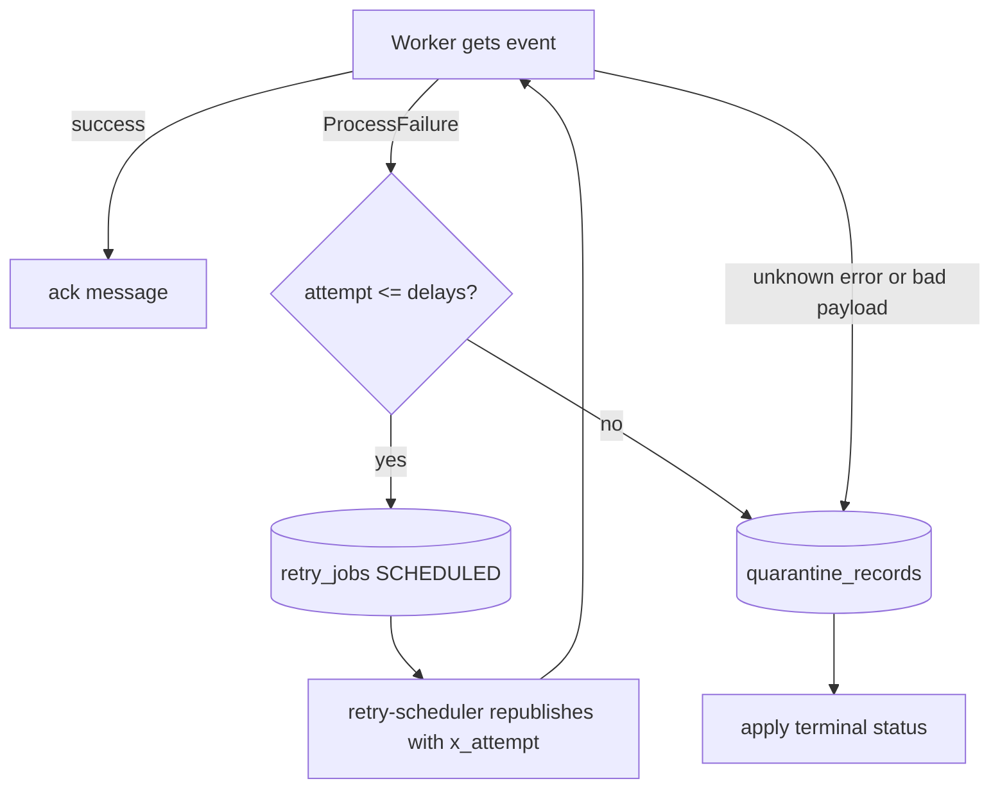

# 10. Failure Handling, Retries and Quarantine

## Purpose

- This document explains what happens when a worker fails.
- It explains durable retries, quarantine, failure injection, and crash recovery.
- It answers "how does the order still finish if a container dies?".

## Files involved

- `backend/app/messaging/retries.py` — retry scheduling, quarantine, terminal effects.
- `backend/app/messaging/consumer.py` — decides whether to ack, retry, or quarantine.
- `backend/workers/retry_scheduler.py` — redelivers due retry jobs.
- `backend/workers/common.py` — `maybe_crash(...)` for crash injection.
- `backend/app/core/config.py` — the failure-mode and retry-delay settings.
- `backend/tests/test_recovery.py` — the tests that prove these behaviours.

## The three kinds of failure

1. **Known, retryable failure** — the worker raises `ProcessFailure`. Example: a simulated payment failure.
2. **Unknown error** — any other exception. The event is moved to quarantine because retrying may not help.
3. **Malformed event** — the payload cannot be parsed. It is quarantined immediately.

## How it works

### Known retryable failure

1. The worker's effect raises `ProcessFailure`.
2. `EventConsumer._on_message` catches it and calls `schedule_retry(...)`.
3. `schedule_retry` writes a `retry_jobs` row with `next_attempt_at = now + delays[attempt-1]`.
4. The original message is acked (removed from the queue) because the retry is now stored safely in the database.
5. The `retry-scheduler` finds due jobs and republishes them to the original queue with an `x_attempt` header.
6. The worker reads `x_attempt` and counts a higher attempt number.

`backend/app/messaging/retries.py`:

```python
if attempt <= len(delays):
    next_attempt_at = datetime.now(timezone.utc) + timedelta(seconds=delays[attempt - 1])
    ...
    await session.execute(
        pg_insert(RetryJob)
        .values(
            event_id=envelope.event_id,
            queue_name=queue_name,
            envelope=envelope.to_dict(),
            attempts=attempt,
            max_attempts=len(delays),
            next_attempt_at=next_attempt_at,
            status="SCHEDULED",
        )
        .on_conflict_do_update(...)
    )
```

- The retry lives in PostgreSQL, so it survives a restart of the scheduler or the worker.
- `RETRY_DELAYS_SECONDS` defaults to `2,10,30`, so there are three retries after the first attempt.

### Retrying safely without duplicates

- Before retrying, the worker already recorded the failure and did *not* commit the business change.
- If the worker had committed and then crashed, the dedupe row in `processed_events` would stop a duplicate effect.

### Attempts exhausted → quarantine

`backend/app/messaging/retries.py`:

```python
else:
    await quarantine_event(
        consumer_name=consumer_name,
        event_id=envelope.event_id,
        queue_name=queue_name,
        reason="attempts_exhausted",
        envelope=envelope.to_dict(),
        apply_terminal=True,
    )
```

- After the last delay, `quarantine_event` runs.
- It writes a `quarantine_records` row.
- It may publish to the `quickbite.quarantine` exchange.

### Terminal business effects

`_apply_terminal_effects` in `retries.py` decides the final status:

- `payment.queue` exhausted → order becomes `PAYMENT_FAILED`, and `order.payment.failed` is emitted.
- `restaurant.queue` or `delivery.queue` exhausted → order becomes `FAILED`, and `order.failed` is emitted.
- Any other queue (for example notifications) → no business change.

- Notifications are explicitly allowed to fail without affecting the order. This is stated in the code comment: "Notification failures must never change business status".

### Crash injection

`backend/workers/common.py`:

```python
def maybe_crash(point: str, event_id: str) -> None:
    if settings.WORKER_CRASH_POINT == point:
        logger.error("injected crash at %s", point, extra={"event_id": event_id})
        os._exit(1)
```

- Setting `WORKER_CRASH_POINT=before_tx` kills the process before the transaction starts.
- Setting `WORKER_CRASH_POINT=after_tx` kills it just after the commit, simulating "committed but not acked".
- Because the message was never acked, RabbitMQ redelivers it. The dedupe table prevents a duplicate effect.

### Failure mode settings

From `backend/app/core/config.py` and `.env.example`:

| Setting | Values | Effect |
|---|---|---|
| `PAYMENT_FAILURE_MODE` | `none`, `twice_then_succeed`, `always_fail` | Controls simulated payment failure. |
| `RESTAURANT_FAILURE_MODE` | `none`, `always_fail` | Controls simulated restaurant failure. |
| `DELIVERY_FAILURE_MODE` | `none`, `always_fail` | Controls simulated driver failure. |
| `NOTIFICATION_FAILURE_MODE` | `none`, `always_fail` | Controls simulated notification failure. |
| `WORKER_CRASH_POINT` | `none`, `before_tx`, `after_tx` | Kills a worker at a chosen point. |

### The outbox's own retry

- The dispatcher also retries: if publishing fails, it sets `next_retry_at` with an exponential backoff capped at 60 seconds.
- This is separate from worker retries and protects against RabbitMQ being briefly unavailable.

## Failure flow diagram



## Data flow

- **Enters the retry system:** a `ProcessFailure` plus the event envelope and the current attempt.
- **The database writes:** a `retry_jobs` row (status `SCHEDULED`).
- **The scheduler writes:** `status = DONE` after a successful republish, and sends a new message to the queue.
- **Quarantine writes:** a `quarantine_records` row, plus a terminal order update when applicable.
- **The user sees:** either the order completing late, or a `PAYMENT_FAILED` / `FAILED` status with a reason.

## Example

- Set `PAYMENT_FAILURE_MODE=twice_then_succeed` and place an order.
- Attempt 1 fails, and a `retry_jobs` row is scheduled for +2 seconds.
- Attempt 2 fails, and the row is rescheduled for +10 seconds.
- Attempt 3 succeeds, so the order becomes `PAID` and continues normally.
- The tracking screen shows `PENDING` for a while, then `PAID`.
- With `always_fail`, all attempts fail and the order ends at `PAYMENT_FAILED`.

## What to remember

- Known failures are retried with delays from `RETRY_DELAYS_SECONDS` (default `2,10,30`), stored safely in `retry_jobs`.
- After the last attempt, the event is quarantined and the order gets a terminal status.
- `processed_events` makes redelivery safe: the same event never takes effect twice.
- Notification failures never change the order status.
- Crash injection (`WORKER_CRASH_POINT`) and failure modes make these behaviours easy to test.

## Builds on

- 4. Request and Data Flow
- 7. Backend Routing and Persistence
- 9. Order Pipeline, Messaging and Workers
